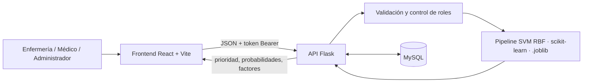

# Arquitectura implementada

Flujo: registro del paciente → `POST /api/atenciones` → validación → SVM → guarda entrada, prioridad ML y evento →
resultado → revisión profesional (`PATCH .../revision`, motivo obligatorio si cambia) → cola ordenada (`GET /api/cola`).
